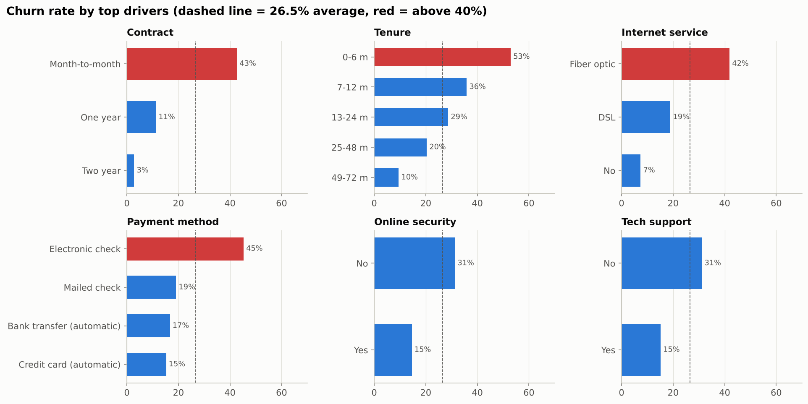
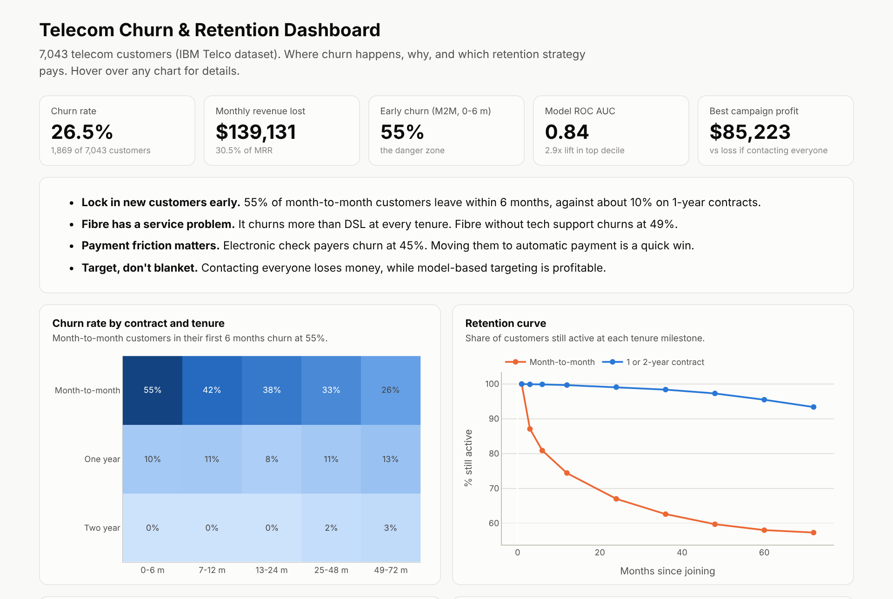

# Telecom Customer Churn & Retention Strategy

**Why 1 in 4 telecom customers leave, who will leave next, and a retention plan that makes money instead of losing it.**


**[Live interactive dashboard](https://ahmaduzzam31.github.io/telecom-churn-retention/)** ·
**[Full analysis notebook](notebooks/churn_analysis.ipynb)** ·
**[Executive summary](reports/executive_summary.md)** ·
**[Power BI build guide + DAX](powerbi/)**

---

## Business problem
A telecom provider lost **26.5%** of its customers and **$139k of monthly recurring revenue (30.5% of MRR)**.
Leadership asked three questions:
1. **Why** are customers leaving?
2. **Who** is most likely to leave next?
3. **Which** retention action gives the best return?

## Key results

| | Finding |
|---|---|
| ⏱️ **Lifecycle** | Month-to-month customers churn at **55% in their first 6 months**, against about 10% on 1-year contracts. |
| 📡 **Fibre problem** | The premium fibre product churns at **42%** (DSL 19%) and churns more **at every tenure**. Without tech support it reaches **49%**. |
| 💳 **Payment friction** | Electronic-check payers churn at **45%**, against **15 to 17%** on automatic payment. |
| 🤖 **Prediction** | Logistic regression **ROC AUC 0.84**. The top 10% riskiest customers churn at **2.9x** the average. |
| 💰 **Retention ROI** | Contacting everyone **loses $129k**. Targeting by risk × value **earns $85k** (stated assumptions). |
| 🧪 **A/B test** | About **214 customers per arm** detects a 20% churn reduction in the "Save now" segment. |



## Dashboard preview


## Approach

| Step | What I did | Skills shown |
|---|---|---|
| 1. Data modelling | Cleaned the raw extract (blank charges for new customers, inconsistent "No service" labels) and split it into a **4-table star schema** | Data cleaning, data modelling |
| 2. SQL analysis | 7 queries: KPIs and MRR at risk, contract × tenure matrix, fibre vs DSL, payment friction, bundle stickiness, retention curve, high-value at-risk list | SQL: joins, CTEs, `NTILE`, `UNNEST`, conditional aggregation |
| 3. Driver analysis | Chi-square tests and **Cramér's V** ranking of 17 attributes | Statistics |
| 4. Fibre deep dive | Controlled comparison (within month-to-month, by tenure) plus a data request for network KPIs | Domain knowledge (telecom / ECE), root-cause thinking |
| 5. Prediction | Logistic regression (odds ratios) vs gradient boosting, stratified split, ROC/PR AUC, decile lift | Machine learning, explainability |
| 6. Targeting ROI | Expected value = P(churn) × save rate × 12-month margin − offer cost. Compared 4 strategies | Business case, decision analysis |
| 7. Segmentation | Risk × value matrix with an action for each segment, plus a target list export | Customer analytics |
| 8. Experiment design | Two-proportion power calculation, primary metric and guardrails | A/B testing |
| 9. BI | Plotly dashboard (GitHub Pages) plus Power BI data model and **DAX measures** | Dashboarding, Power BI |

## Repository structure
```
├── data/
│   ├── raw/telco_customer_churn.csv
│   └── processed/              # customers, subscriptions, billing, churn (star schema) + telco_clean
├── sql/                        # 7 analysis queries
├── notebooks/churn_analysis.ipynb
├── src/
│   ├── prepare_data.py         # cleaning + star schema
│   ├── build_dashboard.py      # -> docs/index.html
│   └── style.py, dashboard_kit.py
├── powerbi/                    # DAX measures + build guide
├── reports/
│   ├── executive_summary.md
│   ├── retention_strategy_roi.csv
│   ├── retention_target_list_top500.csv
│   └── figures/
└── docs/index.html             # dashboard (GitHub Pages)
```

## Reproduce
```bash
pip install -r requirements.txt
./run_all.sh
```

## Sample SQL: high-value customers at risk
```sql
WITH active AS (
    SELECT c.customer_id, c.tenure_months, b.contract, b.monthly_charges, s.tech_support,
           NTILE(4) OVER (ORDER BY b.monthly_charges DESC) AS revenue_quartile
    FROM customers c
    JOIN billing b       USING (customer_id)
    JOIN subscriptions s USING (customer_id)
    JOIN churn ch        USING (customer_id)
    WHERE ch.churned = 0
)
SELECT customer_id, tenure_months, monthly_charges
FROM active
WHERE revenue_quartile = 1 AND contract = 'Month-to-month'
  AND tenure_months < 12 AND tech_support = 'No'
ORDER BY monthly_charges DESC;
```

## Assumptions and limitations
- **Retention economics are illustrative:** $60 offer cost, 30% save rate, 60% margin, 12-month value horizon. All are set in one notebook cell, and the A/B test is designed to measure the real save rate.
- The data is a single snapshot, so tenure is used as a lifecycle proxy (no true cohort dates).
- There is no network-quality or complaints data. The fibre hypothesis is flagged as a data request, not a conclusion.

## Why this project
With an Electronics & Communication Engineering background, I wanted to look beyond the usual churn charts:
the **fibre finding** is the kind of insight where knowing how the network side works helps an analyst ask the right next
question of the engineering team.

**Data source:** [IBM Telco Customer Churn sample dataset](https://github.com/IBM/telco-customer-churn-on-icp4d).
